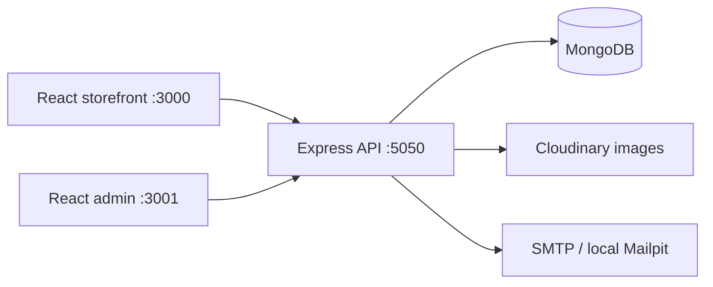

# Architecture

Notervo uses three npm workspaces with one lockfile and one Git repository. The consolidation keeps the existing application boundaries so each app can still run and eventually deploy independently.

## Applications

The storefront has product discovery, product details, guest and account carts, wishlists, registration, login, cash-on-delivery checkout, order confirmation, and account pages. Routes load lazily so customers do not download every page immediately.

The administration app manages catalog data, customers, orders, categories, coupons, subscriptions, and messages. API middleware enforces administrator authorization; browser guards are only a user-experience measure.

The API separates process startup (`index.js`) from HTTP setup (`app.js`). Startup validates configuration and waits for MongoDB. Routes attach authentication, role checks, upload limits, and checkout validation before controllers. Models define persistence constraints. Utility modules contain pricing and email rendering.

## Data and orders

Users reference carts, wishlists, and orders. Products contain notebook variants, prices, images, and stock information. Orders retain item name, image, price, and selected-variant snapshots, so later product edits do not change the receipt. Prices are recomputed on the server. The existing [entity relationship diagram](../apps/backend/The%20project%20Entity%20Relationship%20Diagram.pdf) is a historical reference; model files are authoritative.

Guest orders have no user reference. Creation returns a signed capability for retrieving that order. The browser stores it in session storage, and account authorization rejects guest capabilities. Clearing session storage loses guest access; no self-service recovery flow exists yet.

Checkout checks availability and requested stock, but inventory reservation, order persistence, cart clearing, and coupon redemption are not yet one atomic transaction. Stock is not decremented by the current checkout controller. This is a launch blocker, not a completed inventory system.

The two pricing utilities are still duplicated between browser and API. Their behavior should move to a tested shared package when a stable currency contract is introduced. Current amounts use JavaScript numbers rounded to two decimals; future payment integration should use integer minor units and explicit currency codes.
